

  <a href="https://sandworm-lazarus.pages.dev/"></a>

  
  
  

  <a href="https://sandworm-lazarus.pages.dev/library"></a>

  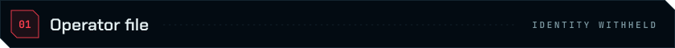 
  <a href="https://sandworm-lazarus.pages.dev/portfolio"></a>

  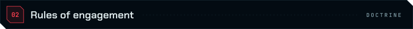 
  <a href="https://sandworm-lazarus.pages.dev/standards"></a>

  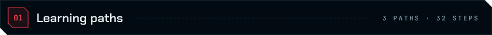 
  <a href="https://sandworm-lazarus.pages.dev/paths#safety">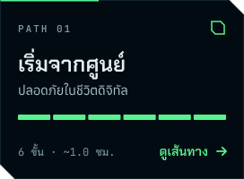</a>
  <a href="https://sandworm-lazarus.pages.dev/paths#foundation">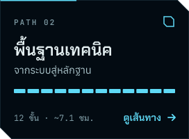</a>
  <a href="https://sandworm-lazarus.pages.dev/paths#soc">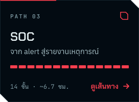</a>

  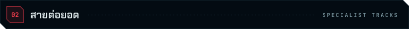 
  <a href="https://sandworm-lazarus.pages.dev/paths"></a>

  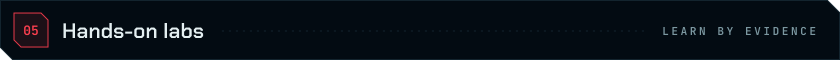 
  <a href="https://sandworm-lazarus.pages.dev/labs"></a>

  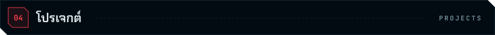 
  <a href="https://github.com/Sandworm-Lazarus/sandworm-arsenal">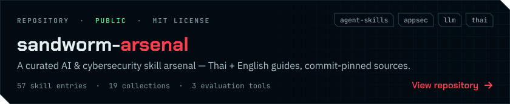</a>

  <a href="https://sandworm-lazarus.pages.dev/">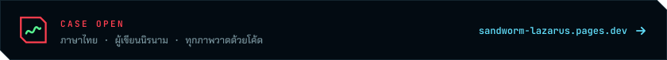</a>

